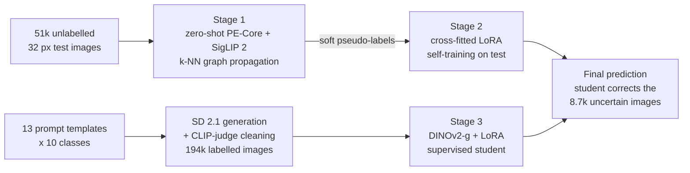
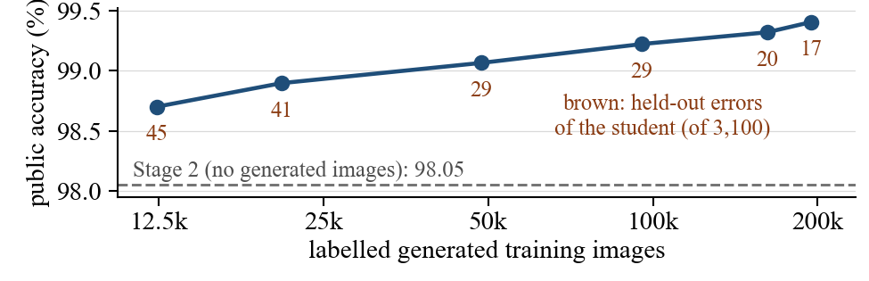

# 1st place, MVA RecVis 2026 Kaggle challenge: classifying synthetic CIFAR-10 at 32 px

**Rank 1 of 104 teams · 99.376% final (private) accuracy · 99.406% public accuracy**

The challenge of the *Object Recognition and Computer Vision* course (MVA master, 2026) gives real CIFAR-10 as training data and asks for the classes of 51,077 **synthetic** test images, stored at 32×32 pixels. The domain gap is large: the provided ResNet-18 baseline reaches 85% on CIFAR-10 validation and **48%** on the test set. No test label is available, closed or API-only models are not allowed, and the public dataset that the test images come from could not be used.

My solution never trains on CIFAR-10. It learns from the test domain itself and reduces the error of the strongest zero-shot model (PE-Core bigG) by a factor of about 5.7, from 3.5% to 0.6% on the private test set. Second place reached 99.023%, so my final file makes 36% fewer errors.

**[One-page paper (CVPR format)](report/A3_HASANOV_Elgun.pdf)** · **[Code and order of the runs](src/README.md)**

## The key idea

The test images are the diffusion-generated part of the CIFAR-10-W benchmark. The CIFAR-10-W paper names the generator (Stable Diffusion 2.1) and the 13 prompt templates ("sketch of {class}", "photo of lego model of {class}", ...), but not the sampler settings or how the images were reduced to 32 px. I reproduced the recipe with the public SD 2.1 weights and generated **213k labelled images** myself: the label of an image is the class in its prompt.

Labelled images from the right domain are only useful if the recipe really matches the test set, and I had no test labels to check it. So I validated it **without labels**:

- **Feature-space mixing.** Among the 20 nearest neighbours of a generated image, 93.3% are test images, against 94.2% for a held-out part of the test set itself. Other generators are far off (SD 1.5: 81.8%, SD-Turbo: 46.5%).
- **Image statistics.** I compared 18 ways of reducing images to 32 px. Bicubic interpolation without antialiasing matches the radial power spectrum of the test images best.

A DINOv2 ViT-g/14 student fine-tuned with LoRA on these images took the public accuracy from **98.05% to 99.41%**.

## Pipeline



1. **Zero-shot prior and graph (97.57%).** PE-Core bigG/14 and SigLIP 2 classify the upsampled images with 80 prompt templates. A k-NN graph over the whole test set, built on their features and on DINOv2 ViT-g features, propagates the probabilities so that confident images correct their uncertain neighbours.
2. **Self-training on the test set (98.05%).** LoRA adapters on all three encoders are trained on the test images with the Stage 1 probabilities as soft targets. Training is **cross-fitted**: each student is trained on one half of the test set and only predicts the other half, so it cannot simply confirm its own pseudo-labels.
3. **Supervised student on generated data (99.41%).** A DINOv2 ViT-g/14 with LoRA and a cosine classifier is trained on 194,495 cleaned generated images. It changes the Stage 2 prediction only on the 8,664 test images where Stage 2 is below 0.9 confidence (geometric mean of the two probability vectors).

## Results

| System | Public (%) | Private (%) |
|---|---:|---:|
| ResNet-18 trained on CIFAR-10 (provided baseline) | 48.205 | 48.141 |
| PE-Core bigG, zero-shot | 96.652 | 96.467 |
| + k-NN graph propagation | 97.004 | 96.993 |
| + SigLIP 2, selective flip | 97.363 | 97.247 |
| + DINOv2-g features in the graph (Stage 1) | 97.565 | 97.435 |
| + cross-fitted LoRA self-training (Stage 2) | 98.048 | 97.983 |
| + DINOv2-g student on 12k generated images | 98.701 | 98.724 |
| + the same on 194k generated images (Stage 3) | **99.406** | 99.345 |
| Stage 3 with two training seeds (**final submission**) | 99.373 | **99.376** |

<p align="center"></p>

More generated data helped at every scale from 12k to 194k images.

## How I avoided overfitting the leaderboard

The public leaderboard is only 30% of the test set (15,323 images), so a small gain on it can be pure noise. Three things kept the decisions honest:

- **A labelled proxy for the test set.** I held out four ranges of generation seeds (18k images) that no model ever trained on, and scored every candidate on them inside the test graph. On 3,100 of these images Stage 1 makes 82 errors and the final student 17.
- **A noise model for the public score.** Two files that differ in *m* labels have a public-score noise of about √(0.3·m)/15,323. I treated differences below about two such units as noise.
- **Pre-registered gates.** For the later submissions I wrote down in advance what a file had to pass (held-out errors, CIFAR-10 sanity check, number of changed labels).

The ranking held on the hidden 70% of the test set, which decides the final leaderboard.

## What did not work

These ideas were tested and rejected with measurements:

- A second round of self-training on its own output (97.60%).
- Joint training on generated images and pseudo-labelled test images.
- A supervised bigG student: worse than DINOv2-g at four times the cost.
- Classifier heads fitted on images from other generators: no transfer.

## Compute

The whole project ran on one server with two RTX 2080 Ti GPUs (11 GB each):

- Generating 213k images took about 4 s per image, about 10 GPU-days in total.
- Training one Stage 3 student on 194k images took about 10 hours.

## Rules

All models have open weights: PE-Core, SigLIP 2, DINOv2, Stable Diffusion 2.1 and DFN5B CLIP. No test label was read, annotated or reconstructed. No CIFAR-10-W data was downloaded or used; only the prompt templates published in its paper. CIFAR-10.1, CIFAR-10.2 and a few DomainNet images served only as labelled check sets for early design choices.

## Repository

```
report/    one-page paper (PDF and LaTeX source), figure script
src/       code of the final model; src/README.md gives the order of the runs
LICENSES/  license of the starter files provided by the course
```

The repository contains code and the paper only: no competition data, no test predictions, no generated images and no weights.

## Acknowledgments

Challenge and starter code: the RecVis 2026 course team ([starter repository](https://github.com/fcendra-enpc/recvis26_a3)). Test domain: *CIFAR-10-Warehouse* (Sun et al., ICLR 2024). Models: PE-Core and DINOv2 (Meta), SigLIP 2 (Google), Stable Diffusion 2.1 (Stability AI), DFN5B CLIP (Apple).

## License

MIT for my code (`LICENSE`). The starter files `src/main.py`, `src/model.py`, `src/data.py` and `src/requirements.txt` keep their original MIT license (`LICENSES/starter-MIT.txt`).
